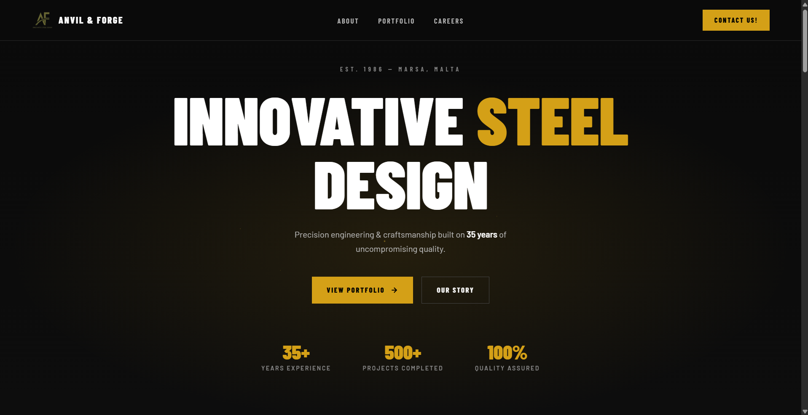

# Anvil & Forge — Landing Page

Landing page for **Anvil & Forge**, a steel design and fabrication company based in Marsa, Malta (est. 1986).
Built as part of a team during my web development internship in Malta (April – May 2026).

🔗 **Live site:** [anvilandforge.mt](https://anvilandforge.mt/)



## About the project

The goal was to give the company a modern single-page website to present its work, attract new clients and recruit staff. The page includes:

- **Hero section** with background video, key figures (years of experience, completed projects) and calls to action
- **About** section presenting the company and its values
- **Portfolio** gallery showcasing featured staircases, railings and custom metalwork
- **Careers** section with an open job offer for metal fabricators and welders
- **Contact** section with embedded Google Maps location, social video and opening hours
- Fully **responsive** layout for desktop and mobile

## Tech stack

- HTML5
- CSS3
- Media hosted on Cloudinary

## My contribution

This was a team project. My main responsibilities were:

- Building the portfolio gallery section
- Making the layout responsive for mobile devices
- Implementing the contact section with the embedded map

## Run locally

```bash
git clone https://github.com/kevinalinstefan/landing-page-anvil-f.git
cd landing-page-anvil-f
```

Then open `index.html` in your browser.

---

*All content, images and branding belong to Anvil & Forge. This repository is shared for portfolio purposes.*
